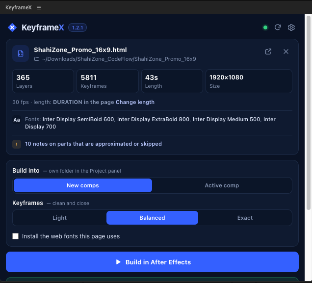
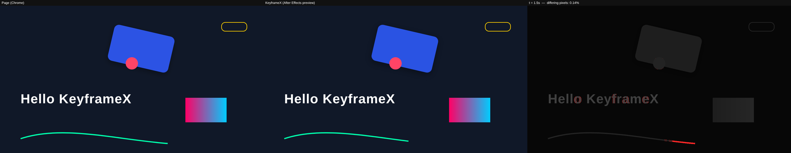
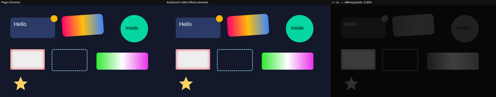
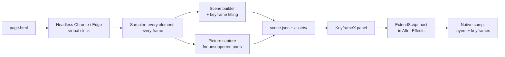

# KeyframeX

**Turn HTML motion videos into native, editable After Effects compositions.**


KeyframeX is an After Effects panel. You drop an HTML animation on it (made with CSS,
GSAP, the Web Animations API, SVG, `requestAnimationFrame` or canvas). KeyframeX plays the
page frame by frame in a hidden Chrome or Edge, measures every element, and rebuilds the
animation as real After Effects layers:

- text layers in the font the page actually used, with tracking, leading and alignment
- shape layers with fills, strokes, rounded corners and bezier paths
- track mattes for `overflow: hidden` and `clip-path`
- Drop Shadow, Gaussian Blur and Gradient Ramp effects
- footage layers for images and video (with Time Remap), audio layers
- position, scale, rotation and opacity keyframes with proper bezier eases

The result is an ordinary After Effects comp that a motion designer can open, retime and
restyle by hand.

<p align="center">
  
</p>

---

## Contents

- [Why KeyframeX](#why-keyframex)
- [How close is the result?](#how-close-is-the-result)
- [Install](#install)
- [Quick start](#quick-start)
- [What converts](#what-converts)
- [How it works](#how-it-works)
- [Command line](#command-line)
- [Writing pages that convert well (AI skills)](#writing-pages-that-convert-well-ai-skills)
- [The scene format](#the-scene-format)
- [Repository layout](#repository-layout)
- [Testing](#testing)
- [Known limitations](#known-limitations)
- [Troubleshooting](#troubleshooting)
- [Documentation](#documentation)
- [Background](#background)

---

## Why KeyframeX

HTML is a fast way to make motion graphics, especially when an AI writes the code. But a
video editor needs the animation **inside After Effects**, where it can be edited, not as a
flat render. KeyframeX bridges that gap:

| | |
|---|---|
| **Editable output** | Real text, shape, footage and audio layers with keyframes, not a video file. |
| **Faithful** | Positions, sizes and layer order come from the browser's own layout and paint order. |
| **Clean keyframes** | Motion is fitted into a few bezier keys with After Effects eases, not one key per frame. Light / Balanced / Exact presets. |
| **Nothing lost** | Parts After Effects can't build natively come in as pictures in the right place, with their motion still as keyframes. |
| **Honest** | Every approximation is listed in the panel and in `report.md`. |
| **Self-contained** | No npm dependencies, no build step, no account. Uses the Chrome/Edge already on the computer. |

## How close is the result?

`tools/compare.js` renders the converted scene the way After Effects builds it and
compares it with the real page, frame by frame (left: Chrome, middle: KeyframeX, right:
differences in red). The test suite requires less than 1% differing pixels on its test
pages.



*CSS animation, Web Animations, an SVG draw-on and a 2-colour gradient. 0.14% of pixels differ.*



*Features with no After Effects equivalent (`::after` decorations, 5-colour gradients,
`mask-image`, multiple shadows, dashed borders, SVG `<use>`) come in as pictures. The text
on top stays an editable text layer.*

On a real 43-second, 1920×1080 promo (365 layers, 5,800 keyframes), checked inside
After Effects 2024 with `tools/diag-text.jsx`, every text layer lands where the page puts
it. The remaining differences are CSS 3D tilts, which are flattened to 2D.

## Install

**You need:** After Effects 2022 (v22) or newer on macOS or Windows, and Google Chrome,
Microsoft Edge, Brave or Chromium on the same computer.

```bash
git clone https://github.com/shahemtiaj/keyframex.git
cd keyframex/KeyframeX/install

bash install-mac.sh             # macOS
# install-windows.cmd           # Windows: double-click it instead
```

Restart After Effects, then open **Window → Extensions → KeyframeX**.

The script copies the panel into your user's CEP extensions folder and enables loading
unsigned extensions (CEP "debug mode"). It also moves any other KeyframeX copy to the
Trash, so After Effects can't load an old copy instead. For a signed `.zxp`, uninstalling
and the data folder, see [KeyframeX/docs/INSTALL.md](KeyframeX/docs/INSTALL.md).

## Quick start

1. Open **Window → Extensions → KeyframeX**. The dot in the header turns green when the
   panel is connected to After Effects.
2. Drop an `.html` file on the panel (try `KeyframeX/tests/fixtures/basic.html`). It
   converts straight away and shows its progress.
3. Review the result: layer and keyframe counts, length, comp size, fonts, and notes on
   anything approximated or skipped.
4. Pick **Build into** (*New comps* or *Active comp*) and **Keyframes** (*Light*,
   *Balanced* or *Exact*), then click **Build in After Effects**.

Other things the panel can do:

- **Wrong length?** Click *Change length*, type the seconds and convert again.
- **Fonts:** turn on *Install the web fonts this page uses* to install `@font-face` and
  Google Fonts for After Effects. Missing fonts are shown in red.
- **Online media:** pictures and clips loaded from the web are downloaded next to the page.
  *Relink in AE* swaps placeholders for files you saved yourself.
- **Re-open a scene:** drop a `scene.json` (or a folder that has one) to build it again
  without converting.

### Making a page KeyframeX understands

```html
<div id="stage" style="width:1920px;height:1080px;position:relative;overflow:hidden">
  <h1 id="title">Hello</h1>
</div>
<script>
  const DURATION = 6;   // seconds: the comp length
  // animate with CSS, GSAP, the Web Animations API or requestAnimationFrame
</script>
```

- A fixed-size stage (`#stage`, `.stage` or `data-kx-stage`) sets the comp size.
- `const DURATION = …` sets the length (otherwise KeyframeX uses the GSAP timeline or CSS
  animation end, or plays until the page stops moving).
- Put media and fonts in an `assets/` folder next to the page.

The full rules are in the [authoring guide](KeyframeX/shared/authoring-guide.md).

## What converts

### Native, editable layers

| In the page | In After Effects |
|---|---|
| `div` with background colour, border, `border-radius` | Shape layer (rectangle, fill, stroke, roundness) |
| `translate` / `scale` / `rotate`, `opacity` (CSS, GSAP, WAAPI, rAF) | Position / Scale / Rotation / Opacity keyframes with eases |
| Text, including text split into letters or words | Text layers in the rendered font, with tracking, leading and alignment |
| A number counting inside one element (`0%` → `87%`) | One text layer driven by a **Counter** slider |
| A word that changes inside one element | Source Text hold keyframes |
| Colour animation | Fill / colour keyframes |
| `box-shadow`, `filter: drop-shadow()` | Drop Shadow |
| `filter: blur()`, including blur inherited from a parent | Gaussian Blur, animated |
| 2-colour opaque `linear-gradient` / `radial-gradient`, gradient text | Gradient Ramp |
| `mix-blend-mode` | Layer blending mode |
| `overflow: hidden`, `clip-path: inset / circle / ellipse / polygon` (animated too) | Shape matte + track matte |
| SVG `path`, `rect`, `circle`, `ellipse`, `line`, `polyline`, `polygon` | Shape layers with bezier paths; animated `d` becomes path keyframes |
| SVG stroke draw-on (`stroke-dashoffset`) | Trim Paths keyframes |
| SVG `<text>` | Text layer |
| ``, `background-image: url()` | Footage layer (fill / cover / contain); WebP, AVIF and SVG become PNG |
| `<video>` (H.264 MP4) | Footage layer with Time Remap |
| `<audio data-start="0.5">` | Audio layer starting at 0.5 s |
| `<canvas>` / WebGL | PNG still or PNG sequence |

### Pictures (still in place, motion kept as keyframes)

These have no After Effects equivalent. KeyframeX captures just that part on a
transparent background. If only its position, scale, rotation or opacity change, it is
captured once and its motion becomes keyframes. If its look changes, it becomes a PNG
sequence.

- `::before` / `::after` decorations
- gradients with 3+ colours, conic, repeating or layered backgrounds, and gradients that
  fade to transparent (soft glows)
- `mask-image`, `clip-path: url()`, filters like `brightness` or `hue-rotate`
- inset or multiple shadows, dashed / dotted / per-side borders, outlines
- SVG `<use>`, SVG masks / clip-paths / patterns, SVG gradients with 3+ stops

### Approximated or skipped

- CSS 3D (`perspective`, `rotateX` / `rotateY`) is flattened to the closest 2D transform.
- `backdrop-filter` (frosted glass) is not converted.
- Skew is dropped from layers (SVG skew is baked into the path).
- Only the nearest clipping container is applied when clips are nested.

## How it works



1. **Virtual clock.** Before any page script runs, KeyframeX replaces `Date`,
   `performance.now`, `requestAnimationFrame`, timers, CSS / Web Animations, SMIL, media
   time and `Math.random` (seeded). Each frame is an exact moment in time, so the
   capture is repeatable and never drops frames.
2. **Sampling.** At every frame a sampler records each visible element: its transformed
   box (from Chrome's box model), styles, text layout, SVG geometry, clips, effects and its
   place in the browser's paint order (stacking contexts, `z-index`, positioned vs.
   in-flow).
3. **Scene building.** Each element becomes one or more layers. Motion over time is fitted
   into a few cubic-bezier keys with After Effects speed and influence, split at turning
   points, within a tolerance set by the quality preset.
4. **Pictures.** Parts with no native equivalent are captured alone on a transparent
   background in a second pass on the same clock.
5. **Building.** The panel sends the scene to a single ExtendScript file inside After
   Effects. It creates the comp, layers, keyframes, mattes and effects in one undo step,
   and checks the result (for example, that each text layer lands on its spot).

The full design is in [KeyframeX/docs/ARCHITECTURE.md](KeyframeX/docs/ARCHITECTURE.md).

## Command line

The panel and the command line share the same engine. With Node.js 15+ you can convert
pages without After Effects, then drop the resulting `scene.json` on the panel:

```bash
cd KeyframeX
node cli/keyframex.js convert page.html --fps 30 --quality balanced --out out/
node cli/keyframex.js validate out/scene.json
node cli/keyframex.js browsers        # which Chrome / Edge KeyframeX found
node cli/keyframex.js guide           # print the authoring guide

node tools/compare.js page.html --every 1 --out cmp/   # visual check vs. the page
```

Add `--json` for machine-readable output.

## Writing pages that convert well (AI skills)

The [`skills/`](skills/README.md) folder has four vendor-neutral skills (plain Markdown and
JSON, in the open Agent Skills layout) that teach an AI assistant to work with KeyframeX.
The extension itself has no AI features.

| Skill | Use it to |
|---|---|
| [`keyframex-html-motion`](skills/keyframex-html-motion/SKILL.md) | Write HTML motion videos that convert into editable After Effects layers |
| [`keyframex-convert-build`](skills/keyframex-convert-build/SKILL.md) | Convert a page with the CLI, read the notes, hand it over for building |
| [`keyframex-scene-json`](skills/keyframex-scene-json/SKILL.md) | Write or edit `scene.json` directly for exact keyframes, eases, text and mattes |
| [`keyframex-troubleshoot`](skills/keyframex-troubleshoot/SKILL.md) | Diagnose wrong size or length, fonts, placeholders, pictures and host-script errors |

## The scene format

A conversion produces a folder next to the page:

```
My Page (KeyframeX)/
├── scene.json     the comp, layers and keyframes (keyframex.scene v1)
├── report.md      layer / keyframe counts, fonts, notes
├── assets/        pictures, sequences, converted images
└── fonts/         web fonts the page used (when fonts are installed for After Effects)
```

`scene.json` is plain JSON with a schema and a validator, so it can also be written by
hand or by a script:

```json
{
  "format": "keyframex.scene", "version": 1,
  "comp": { "name": "Hello", "width": 1920, "height": 1080, "fps": 30, "duration": 4 },
  "layers": [{
    "id": "t1", "type": "text", "name": "Title", "in": 0, "out": 4,
    "text": { "font": { "family": "Inter", "weight": 700 }, "size": 120,
              "justify": "center", "color": [1, 1, 1], "source": { "value": "Hello" } },
    "transform": {
      "anchor": { "value": [0, 0] },
      "position": { "keys": [ { "t": 0, "v": [960, 640] }, { "t": 1, "v": [960, 580] } ] },
      "opacity":  { "keys": [ { "t": 0, "v": 0 },          { "t": 1, "v": 100 } ] }
    }
  }]
}
```

Reference: [KeyframeX/docs/SCENE_FORMAT.md](KeyframeX/docs/SCENE_FORMAT.md) and
[the JSON schema](KeyframeX/engine/schema/scene.schema.json). A complete example is in
[KeyframeX/examples/hand-written-scene.json](KeyframeX/examples/hand-written-scene.json).

## Repository layout

```
keyframex/
├── KeyframeX/                 the After Effects extension
│   ├── CSXS/manifest.xml      CEP manifest (panel, AE 22+)
│   ├── client/                panel UI (HTML, CSS, small scripts)
│   ├── engine/                converter: CDP client, virtual clock, sampler, fitting,
│   │                          scene builder, pictures, assets, fonts, validator
│   ├── host/keyframex.jsx     ExtendScript that builds the comp inside After Effects
│   ├── shared/                settings, panel ↔ host pipeline, authoring guide
│   ├── cli/                   command line
│   ├── tools/                 compare.js, preview.js, diag-text.jsx
│   ├── install/               install / uninstall / ZXP packaging scripts
│   ├── examples/              hand-written scene
│   ├── tests/                 test runner, strict After Effects mock, fixture pages
│   └── docs/                  install, architecture, scene format, testing, changelog
├── skills/                    AI skills for writing pages and scenes
└── docs/images/               images used in this README
```

## Testing

```bash
cd KeyframeX
node tests/run.js
```

38 tests, no npm install needed (the strict ES3 check of the host runs when `acorn` is
installed). Without Chrome or Edge on the machine, the browser tests are skipped, not
failed. They cover:

- **Unit:** keyframe fitting, SVG path parsing (including compact design-tool syntax),
  clip-path, scene validation.
- **Conversion:** real Chrome conversions of the fixture pages (CSS, WAAPI, GSAP, media,
  edge cases, pictures, paint order, promo patterns).
- **Look:** visual comparison against Chrome, less than 1% differing pixels.
- **Host:** every fixture is built in a strict mock of the After Effects scripting API.
  The mock reproduces real After Effects quirks, such as the justification bug.
- **Project:** the ExtendScript host is valid ES3 with no reserved-word keys.

The GSAP test needs `tests/fixtures/assets/gsap.min.js`, which is not in the repository
(get it with `npm pack gsap`); without it that test is skipped. Inside After Effects,
`tools/diag-text.jsx` reports the anchor, position, drawn bounds and paragraph settings
of every text layer in the active comp. Details: [KeyframeX/docs/TESTING.md](KeyframeX/docs/TESTING.md).

## Known limitations

- **CSS 3D** is flattened to 2D. Up to about 25 px off at the corners of tilted mockups.
  KeyframeX does not build a 3D camera yet.
- **`backdrop-filter`** is skipped.
- **Pictures are not editable.** A picture keeps its motion as keyframes, but its look
  is a PNG.
- **Video** must be H.264 MP4. After Effects can't open WebM.
- **Unsigned by default.** The install script enables CEP debug mode. Use
  `install/package-zxp.sh` to make a signed `.zxp`.

## Troubleshooting

| Symptom | What to do |
|---|---|
| Red dot in the panel header | Click the reload button next to it. If it stays red, reinstall and restart After Effects. |
| "No browser found" | Install Chrome or Edge, or set its path in Settings (gear icon). |
| Wrong comp size | Give the stage `id="stage"` or `data-kx-stage` and a fixed pixel size. |
| Wrong length | Add `const DURATION = …;` to the page, or use *Change length*. |
| Missing or substituted fonts | Turn on *Install the web fonts this page uses*, then restart After Effects. |
| Two KeyframeX panels or an old version | Run the install script again. It moves other copies to the Trash. |

More in the [`keyframex-troubleshoot`](skills/keyframex-troubleshoot/SKILL.md) skill.

## Documentation

| | |
|---|---|
| Install and setup | [KeyframeX/docs/INSTALL.md](KeyframeX/docs/INSTALL.md) |
| Architecture | [KeyframeX/docs/ARCHITECTURE.md](KeyframeX/docs/ARCHITECTURE.md) |
| Scene format | [KeyframeX/docs/SCENE_FORMAT.md](KeyframeX/docs/SCENE_FORMAT.md) |
| Authoring guide | [KeyframeX/shared/authoring-guide.md](KeyframeX/shared/authoring-guide.md) |
| Testing | [KeyframeX/docs/TESTING.md](KeyframeX/docs/TESTING.md) |
| Improvements and gaps vs. CodeFlow | [KeyframeX/docs/IMPROVEMENTS.md](KeyframeX/docs/IMPROVEMENTS.md) |
| Changelog | [KeyframeX/docs/CHANGELOG.md](KeyframeX/docs/CHANGELOG.md) |
| Contributing | [CONTRIBUTING.md](CONTRIBUTING.md) |

## Background

KeyframeX is an independent, clean-room implementation. The extension it replaces
(CodeFlow 2.0.0 by Ae Flow Tools) is obfuscated and encrypted, and its license forbids
reverse engineering. It was studied only through its public documentation, manifest and
panel layout. None of its code is in this repository.
